# PatchClamp OM — Block Reference

> Complete catalogue of all models, connectors, and functions in the
> **PatchClamp** OpenModelica package. Each table covers one sub-package.
> Icons are the block's actual OMEdit icon, stored in `PatchClamp/Icons/`
> and referenced from each model via a `Bitmap` annotation
> (`modelica://PatchClamp/Icons/<BlockName>.png`). `Step01`–`Step25` in
> `Examples/` intentionally have no per-block PNG (they use a generated
> Rectangle+Text icon instead — see the Examples section below).
>
> See also: [`model-reference.md`](model-reference.md) (prose parameter/output
> reference for Cells and Examples), [`examples-reference.md`](examples-reference.md)
> (what each example demonstrates and how to run it), and
> [`physics-background.md`](physics-background.md) (underlying equations).

---

## 1. Amplifiers

Full path: `PatchClamp.Amplifiers`

| Icon | Block | Description | Key parameters | Connectors | Core equations |
|:----:|-------|-------------|---------------|-----------|---------------|
|  | `VoltageClampAmplifier` | Voltage-clamp amplifier with step protocol | `V_hold`, `V_step`, `t_step_start`, `t_step_end`, `V_ljp_correction` | `p` (Pin\_p), `n` (Pin\_n) | $V_\text{cmd} = V_\text{hold/step} - V_\text{ljp}$; $p.v - n.v = V_\text{cmd}$; $I_\text{meas} = -p.i$ |
| 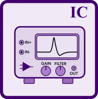 | `CurrentClampAmplifier` | Current-clamp amplifier with two-pulse protocol and bridge balance | `I_hold`, `I_pulse`, `t_pulse_start`, `t_pulse_end`, `I_pulse2`, `R_bridge` | `p` (Pin\_p), `n` (Pin\_n) | $p.i = -I_\text{cmd}$; $V_\text{membrane} = (p.v - n.v) - I_\text{cmd} \cdot R_\text{bridge}$ |
|  | `SealTest` | Repeated square pulse to estimate $R_\text{seal}$ in real time | `V_pulse`, `t_period`, `t_pulse_width`, `t_start`, `R_pipette_nom` | `p` (Pin\_p), `n` (Pin\_n) | $p.v-n.v=V_\text{cmd}$; $\tau_\text{filt}\dot{I}_\text{steady}=I_\text{measured}-I_\text{steady}$; $R_\text{seal,est}=\|V_\text{pulse}/I_\text{steady}\|$ during the pulse, else $R_\text{pipette,nom}$ (no $C_m$ estimate — see note below) |
|  | `RampVoltageSource` | Linear voltage ramp for I–V protocols | `V_start`, `V_end`, `t_ramp` | `p` (Pin\_p), `n` (Pin\_n) | $V_\text{out} = V_\text{start} + (V_\text{end}-V_\text{start})\cdot\min(t/t_\text{ramp},1)$; $p.v - n.v = V_\text{out}$ |

> **Note on `SealTest`:** earlier revisions of this model also computed a
> `C_m_est` variable from `tau_filt / R_pipette_nom`. That variable was
> removed — it never depended on the simulated trace, so it looked like a
> capacitance measurement but wasn't one. Estimating $C_\text{pip}/C_m$ from
> a `SealTest` run is now a manual curve-fitting exercise (see the model's
> own `Documentation` block), and only works when there is a capacitance
> downstream of `R_pipette` (from `Step03` onward — `Step01` has no visible
> capacitive transient because `C_pipette` sits directly in parallel with
> `SealTest`'s ideal, zero-impedance source).

### 1.1 Amplifiers.Compensation

Full path: `PatchClamp.Amplifiers.Compensation`

| Icon | Block | Description | Key parameters | Connectors | Core equations |
|:----:|-------|-------------|---------------|-----------|---------------|
|  | `CompensatedVClampAmp` | Voltage-clamp with integrated C-fast, C-slow, and $R_s$ compensation | `V_hold`, `V_step`, `C_fast`, `frac_fast`, `C_slow`, `R_s_est`, `frac_slow`, `R_s`, `alpha` (0–0.9), `tau_comp` | `p` (Pin\_p), `n` (Pin\_n) | Combines `VoltageClampAmplifier` + all three compensation sub-blocks below; $\alpha>0$ feeds back through a first-order filtered `I_raw_filt` (time constant `tau_comp`, default 15 µs) instead of the instantaneous current — an ideal-bandwidth feedback loop through the two capacitive elements ($C_\text{pipette}$, $C_\text{slow}$) is unstable |
|  | `PipetteCapacitanceComp` | C-fast: cancels pipette capacitive transient | `C_fast`, `fraction` | `p` (Pin\_p), `n` (Pin\_n) | $I_\text{comp} = \text{fraction} \cdot C_\text{fast} \cdot \dfrac{d(p.v - n.v)}{dt}$; signal-only (no circuit load) |
|  | `WholeCellCapacitanceComp` | C-slow: cancels whole-cell capacitive transient | `C_slow`, `R_s_est`, `fraction` | `p` (Pin\_p), `n` (Pin\_n) | $R_{s,\text{est}}\,C_\text{slow}\,\dot{V}_{m,\text{est}} = (p.v-n.v) - V_{m,\text{est}}$; $I_\text{comp} = \text{fraction}\cdot C_\text{slow}\,\dot{V}_{m,\text{est}}$ |
|  | `SeriesResistanceComp` | $R_s$ compensation: corrects voltage error under current flow | `R_s`, `alpha` (0–0.9) | `p` (Pin\_p), `n` (Pin\_n) | $V_\text{error} = R_s \cdot I_\text{measured}$; $V_\text{cmd,corr} = V_\text{cmd} + \alpha\,V_\text{error}$; signal-only |

---

## 2. Cells

All cells inherit from `PartialExcitableCell`, which provides the membrane ODE:

$$C_m \frac{dV_m}{dt} = I_\text{ext} - I_\text{total}, \qquad V_m = \text{membrane\_p.v} - \text{membrane\_n.v}$$

Full path: `PatchClamp.Cells`

| Icon | Block | Description | Key parameters | Core equations |
|:----:|-------|-------------|---------------|---------------|
| 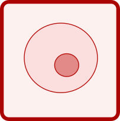 | `PassiveCell` | Passive membrane: $R_m \| C_m$ circuit | `R_m` (1 GΩ), `C_m` (10 pF), `E_L` (−65 mV) | $I_\text{total} = (V_m - E_L)/R_m$ |
|  | `SimplifiedNeuron` | Leaky integrate-and-fire (LIF) with automatic reset | `R_m` (10 MΩ), `V_threshold` (−55 mV), `V_reset` (−70 mV), `V_rest` (−65 mV) | $I_\text{total} = (V_m - V_\text{rest})/R_m$; when $V_m \geq V_\text{thr}$: $\text{reinit}(V_m, V_\text{reset})$ |
| 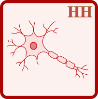 | `HodgkinHuxleyNeuron` | Hodgkin–Huxley neuron: Na⁺, K⁺, leak (HH 1952) | `g_Na_max` (1200 S/m²), `g_K_max` (360 S/m²), `g_L` (3 S/m²), `E_Na`, `E_K`, `E_L` | $I_\text{Na} = g_\text{Na}m^3h(V_m-E_\text{Na})A$; $I_\text{K} = g_\text{K}n^4(V_m-E_\text{K})A$; $I_L = g_L(V_m-E_L)A$; $\dot{m}=\alpha_m(1-m)-\beta_m m$ (likewise $h$, $n$) |
|  | `FitzHughNagumoNeuron` | FitzHugh–Nagumo 2D phenomenological model (FHN 1961) | `a` (0.7), `b` (0.8), `epsilon` (0.08), `tau_u` (2 ms), `V_rest`, `V_scale` | $u=(V_m-V_\text{rest})/V_\text{scale}$; $I_\text{total}=\frac{C_m V_\text{scale}}{\tau_u}(w-u+u^3/3)$; $\dot{w}=\varepsilon(u+a-bw)/\tau_u$ |
| 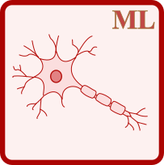 | `MorrisLecarNeuron` | Morris–Lecar 2D biophysical model (ML 1981) | `g_Ca`, `g_K`, `g_L`, `E_Ca`, `E_K`, `E_L`, `V1`–`V4`, `phi` | $m_\infty=\tfrac{1}{2}[1+\tanh((V_m-V_1)/V_2)]$; $\dot{w}=(w_\infty-w)/\tau_w$; $I_\text{Ca}=g_\text{Ca}m_\infty(V_m-E_\text{Ca})A$; $I_K=g_K w(V_m-E_K)A$ |
| 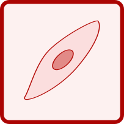 | `PacemakerCell` | Sinoatrial pacemaker: spontaneous automaticity via $I_f$ (HCN) | `g_f`, `E_f`, `V_f_half`, `tau_y`, `g_Ca`, `E_Ca`, `g_K`, `tau_n` | $y_\infty=1/(1+e^{+(V_m-V_{f,1/2})/k_f})$; $\dot{y}=(y_\infty-y)/\tau_y$; $I_f=g_f y(V_m-E_f)A$; $I_\text{Ca}=g_\text{Ca}d_\infty(V_m-E_\text{Ca})A$; $I_K=g_K n^2(V_m-E_K)A$ |
| 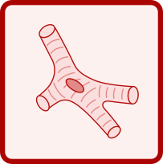 | `CardiacVentricularCell` | Simplified cardiac ventricular AP with Ca²⁺ plateau | `g_Na`, `g_Ca`, `g_K`, `g_K1`, `g_L`, reversal potentials, time constants | $m_\infty=1/(1+e^{-(V_m+45\,\text{mV})/7\,\text{mV}})$; $\dot{m}_\text{Na}=(m_\infty-m_\text{Na})/\tau_m$; $I_\text{Na}=g_\text{Na}m_\text{Na}^3 h_\text{Na}(V_m-E_\text{Na})A$; $I_\text{Ca}=g_\text{Ca}d_\infty f_\text{Ca}(V_m-E_\text{Ca})A$; etc. |

### 2.1 Cells.Interfaces

| Icon | Block | Type | Core equations |
|:----:|-------|------|---------------|
| 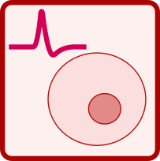 | `PartialExcitableCell` | `partial model` | $V_m = \text{membrane\_p.v} - \text{membrane\_n.v}$; $C_m\dot{V}_m = \text{membrane\_p.i} - I_\text{total}$; $\text{membrane\_p.i} + \text{membrane\_n.i} = 0$ |

---

## 3. Electrodes

Full path: `PatchClamp.Electrodes`

| Icon | Block | Description | Key parameters | Connectors | Core equations |
|:----:|-------|-------------|---------------|-----------|---------------|
|  | `PatchPipette` | Borosilicate patch pipette ($R_\text{pip} + C_\text{pip}$ + LJP) | `R_pipette` (4 MΩ), `C_pipette` (3 pF), `V_junction` (−11 mV) | `p_amp`, `p_cell` (Pin\_p), `n` (Pin\_n) | $V_\text{node}=p_\text{amp}.v+V_\text{jct}$; $i_R=(V_\text{node}-p_\text{cell}.v)/R_\text{pip}$; $i_C=C_\text{pip}\,d(V_\text{node}-n.v)/dt$; $p_\text{amp}.i=i_R+i_C$ |
|  | `AgAgClElectrode` | Ag/AgCl electrode with Nernst junction potential | `V_ref` (222 mV), `c_Cl`, `c_Cl_ref` (150 mM), `T`, `R_contact` | `p` (Pin\_p), `n` (Pin\_n) | $V_\text{elec}=V_\text{ref}-\frac{RT}{F}\ln\!\frac{c_\text{Cl}}{c_\text{Cl,ref}}$; $p.v-n.v=V_\text{elec}+p.i\cdot R_\text{contact}$ |
|  | `BathElectrode` | Reference electrode in perfusion bath (virtual ground) | `R_bath` (100 Ω) | `p` (Pin\_p), `n` (Pin\_n) | $p.v-n.v=p.i\cdot R_\text{bath}$; $n.v=0$ |
|  | `Ground` | Absolute voltage reference | — | `p` (Pin\_p) | $p.v = 0$ |

---

## 4. Interfaces

Full path: `PatchClamp.Interfaces`

| Icon | Connector | Variables | Description |
|:----:|-----------|-----------|-------------|
|  | `ElectricalPin` | `v` [V] (potential); `i` [A] (flow) | Acausal electrical terminal; Kirchhoff: $\sum i = 0$ at connected node |
|  | `ElectricalPin_p` | extends `ElectricalPin` | Positive (+) terminal — red in OMEdit |
|  | `ElectricalPin_n` | extends `ElectricalPin` | Negative (−) terminal — blue in OMEdit |
|  | `IonPort` | `c_in`, `c_out` [mol/m³]; `q` [mol/s] (flow); `ionName`, `charge` | Ionic connector: intra/extracellular concentrations + molar flux; $\sum q = 0$ at node |
|  | `SolutionPort` | `T` [K]; `p` [Pa]; `osmolarity` [mol/m³] | Thermodynamic properties of a physiological bath solution |

---

## 5. Media

Full path: `PatchClamp.Media`

| Icon | Block | Description | Key parameters | Port | Core equations |
|:----:|-------|-------------|---------------|------|---------------|
|  | `InternalSolution` | Whole-cell pipette solution (high K⁺, low Na⁺/Ca²⁺) | `c_K` (140 mM), `c_Na` (10 mM), `c_Cl` (10 mM), `c_Ca` (0.1 µM), `T` | `solutionPort` | Exposes constant concentrations and $T$ on `SolutionPort`; no ODEs |
|  | `ExternalSolution` | Extracellular Ringer/ACSF bath | `c_K` (5 mM), `c_Na` (145 mM), `c_Cl` (110 mM), `c_Ca` (2 mM), `T` | `solutionPort` | Exposes constant concentrations and $T$ on `SolutionPort`; no ODEs |

### 5.1 Media.Functions

Pure functions — callable from any `equation` section.

| Icon | Function | Inputs | Output | Equation |
|:----:|----------|--------|--------|----------|
| 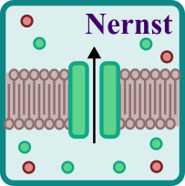 | `nernstPotential` | `T` [K], `z` (valence), `c_out`, `c_in` [mol/m³] | `E` [V] | $E = \dfrac{RT}{zF}\ln\!\dfrac{c_\text{out}}{c_\text{in}}$ |
| 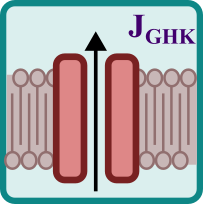 | `ghkCurrentDensity` | `P` [m/s], `z`, `V` [V], `T` [K], `c_in`, `c_out` [mol/m³] | `J` [A/m²] | $x=zVF/(RT)$; $J=P z^2\dfrac{VF^2}{RT}\cdot\dfrac{c_\text{in}-c_\text{out}e^{-x}}{1-e^{-x}}$ (L'Hôpital at $V\!\to\!0$) |

---

## 6. Membranes

Full path: `PatchClamp.Membranes`

| Icon | Block | Description | Key parameters | Connectors | Core equations |
|:----:|-------|-------------|---------------|-----------|---------------|
| 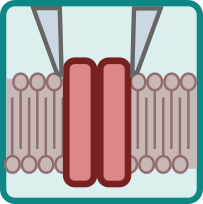 | `CellAttachedPatch` | Cell-attached gigaseal patch: $R_\text{seal} \| (R_\text{patch} \| C_\text{patch})$ | `R_seal` (1 GΩ), `R_patch` (50 GΩ), `C_patch` (0.1 pF) | `p_pip`, `p_ext` (Pin\_p) | $I_\text{seal}=V_\text{patch}/R_\text{seal}$; $I_{R}=V_\text{patch}/R_\text{patch}$; $I_C=C_\text{patch}\,\dot{V}_\text{patch}$; $p_\text{pip}.i=I_\text{seal}+I_R+I_C$ |
| 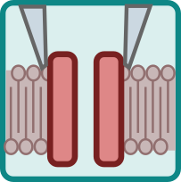 | `SingleChannelPatch` | Single-channel mean-field model, configurable configuration (on-cell / inside-out / outside-out) | `config` (1–3), `c_pipette`, `c_bath`, `c_cell_native`, `gamma` (100 pS), `n_ch`, `V_half`, `k_v` | `membrane_p`, `membrane_n` | $P_{\infty}=1/(1+e^{-(V_m-V_{1/2})/k_v})$; $\tau_\text{ch}=\tau_\text{max}/\cosh(\Delta V/2k_v)$; $\dot{P}_\text{open}=(P_\infty-P_\text{open})/\tau_\text{ch}$; $I=P_\text{open}\,n\,\gamma\,(V_m-E_\text{rev})$ |
| 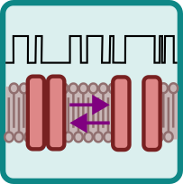 | `StochasticChannel` | Stochastic counterpart of `SingleChannelPatch`: `n_channels` independent 2-state Markov channels, discrete open/close events instead of an ensemble average | `config` (1–3), `c_pipette`, `c_bath`, `c_cell_native`, `gamma`, `n_channels`, `V_half`, `k_v`, `tau_max`, `dt`, `useAutomaticSeed`, `fixedSeed` | `membrane_p`, `membrane_n` | Same $P_\infty(V)$/$\tau(V)$ formalism as `SingleChannelPatch`; $\alpha=P_\infty/\tau$, $\beta=(1-P_\infty)/\tau$; each channel flips via `when sample(0,dt)` with probability $\approx\alpha\,dt$ (closed→open) or $\beta\,dt$ (open→closed); $I_\text{patch}=\sum_i \text{isOpen}_i\cdot\gamma(V_m-E_\text{rev})$ |
| | `LigandGatedChannel` | Stochastic ligand-gated channel patch: `n_channels` independent 2-state Markov channels opened by an agonist pulse (Hill dependence) instead of by voltage; ensemble average integrated alongside. No PNG icon yet (vector icon) | `n_channels`, `gamma` (30 pS), `E_rev`, `EC50` (0.010 mM), `n_hill` (2), `k_close` (200 s⁻¹), `c_agonist`, `t_agonist_on/off`, `dt` | `membrane_p`, `membrane_n` | $k_\text{open}=k_\text{close}(c_L/\text{EC}_{50})^{n}$, $P_{\text{open},\infty}=c_L^n/(c_L^n+\text{EC}_{50}^n)$ |
| 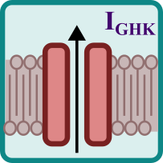 | `GHKConductance` | Single-ion GHK membrane conductance | `z`, `P` (1×10⁻⁸ m/s), `c_in`, `c_out`, `A` (1000 µm²) | `membrane_p`, `membrane_n` | $J=\text{ghkCurrentDensity}(P,z,V_m,T,c_\text{in},c_\text{out})$; $I=J\cdot A$; $E_\text{rev}=\text{nernstPotential}(T,z,c_\text{out},c_\text{in})$ |
|  | `GoldmanMembrane` | Multi-ion membrane: Nernst potentials + GHK currents for K⁺, Na⁺, Cl⁻, Ca²⁺ | `P_K`, `P_Na`, `P_Cl`, `P_Ca` [m/s]; `c_*_in`, `c_*_out` [mM] | `membrane_p`, `membrane_n` | $V_G=\frac{RT}{F}\ln\!\frac{P_K c_{K,o}+P_\text{Na}c_{\text{Na},o}+P_\text{Cl}c_{\text{Cl},i}}{P_K c_{K,i}+P_\text{Na}c_{\text{Na},i}+P_\text{Cl}c_{\text{Cl},o}}$; $I_\text{ion}=\text{ghkCurrentDensity}(\ldots)\cdot A$ per ion |
| 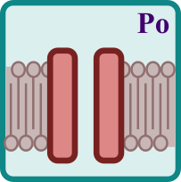 | `MarkovChannel` | 2-state Markov channel (Closed ↔ Open), Ohmic current | `z`, `c_in`, `c_out`, `gamma` (100 pS), `n_channels`, `V_half`, `k_v` | `membrane_p`, `membrane_n` | $P_\infty=1/(1+e^{-(V_m-V_{1/2})/k_v})$; $\dot{P}_\text{open}=(P_\infty-P_\text{open})/\tau_\text{ch}$; $i_u=\gamma(V_m-E_\text{rev})$; $I=P_\text{open}\,n\,i_u$ |
| 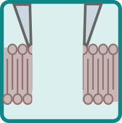 | `WholeCell` | Whole-cell equivalent circuit after patch rupture: $R_\text{access}$ in series with $(C_m \| R_m)$ | `R_access` (10 MΩ), `C_m` (50 pF), `R_m` (200 MΩ), `V_m_init` | `p_pip` (Pin\_p), `p_ext` (Pin\_n) | $I_\text{access}=(V_\text{pip}-V_\text{cell})/R_\text{access}$; $I_{Cm}=C_m\dot{V}_m$; $I_{Rm}=V_m/R_m$; $I_\text{access}=I_{Cm}+I_{Rm}$; uses `PatchClamp.Interfaces` pins directly (not MSL `Analog.Basic`) — see model doc for why |

---

## 7. Examples

Ready-to-simulate experiments. Full path: `PatchClamp.Examples`. All 25 use a
generated (Rectangle+Text) OMEdit icon rather than a per-block PNG, so there
is no icon column here — see [`examples-reference.md`](examples-reference.md)
for full walkthroughs and [`model-reference.md`](model-reference.md) for
detailed per-example parameter/output notes.

| # | Model | Stop time | Concept demonstrated |
|---|-------|:---------:|---------------------|
| 01 | `Step01_PipetteSealTest` | 0.060 s | Pipette in bath — seal-test without a cell (patch-clamp workflow step 1) |
| 02 | `Step02_GigasealFormation` | 0.060 s | Gigaseal formed (cell-attached) — seal-test with a membrane patch (step 2) |
| 03 | `Step03_PassiveCellVoltageClamp` | 0.200 s | Passive cell in voltage-clamp — RC response to a voltage step |
| 04 | `Step04_WholeCellBreakIn` | 0.060 s | Whole-cell — patch rupture and the resulting slow capacitive transient (step 3) |
| 05 | `Step05_PassiveCellCurrentClamp` | 0.150 s | Passive cell in current-clamp — measuring $\tau_m = R_m C_m$ |
| 06 | `Step06_HodgkinHuxleyActionPotential` | 0.050 s | Hodgkin–Huxley action potential in current-clamp |
| 07 | `Step07_RefractoryPeriod` | 0.050 s | HH refractory period — two-pulse protocol |
| 08 | `Step08_NernstEquilibriumPotential` | 1.0 s | Nernst equilibrium potential as a function of extracellular [K⁺] |
| 09 | `Step09_GHKReversalPotential` | 0.500 s | Reversal potential — I–V curve of a GHK channel via direct algebraic calculation |
| 10 | `Step10_GoldmanRestingPotential` | 1.0 s | Two ionic compartments — Nernst, Goldman resting potential, and osmotic balance |
| 11 | `Step11_GHK_IVCurve` | 0.5 s | Multi-ion I–V curve via GHK — voltage-clamp ramp protocol |
| 12 | `Step12_SodiumChannelIVCurve` | 0.180 s | Ionic channel I–V curve — voltage-step ladder protocol |
| 13 | `Step13_SeriesResistanceCompensation` | 0.200 s | Compensation demo: effect of C-fast, C-slow, and $R_s$ on the measured current |
| 14 | `Step14_FitzHughNagumoExcitability` | 0.100 s | FitzHugh–Nagumo in current-clamp: single and repetitive firing |
| 15 | `Step15_MorrisLecarExcitability` | 0.200 s | Morris–Lecar in current-clamp: Type I and Type II excitability |
| 16 | `Step16_CardiacActionPotential` | 0.400 s | Cardiac ventricular action potential — Ca²⁺ plateau (~200 ms) |
| 17 | `Step17_PacemakerAutorhythmicity` | 3.000 s | Sinoatrial pacemaker — spontaneous automaticity without external stimulus |
| 18 | `Step18_OnCellSingleChannel` | 0.200 s | On-cell patch clamp — $P_\text{open}(V)$ activation curve of a Kv channel |
| 19 | `Step19_InsideOutSingleChannel` | 0.300 s | Inside-out patch clamp — BK channel modulated by intracellular Ca²⁺ |
| 20 | `Step20_OutsideOutSingleChannel` | 0.300 s | Outside-out patch clamp — AMPA receptor reversal potential |
| 21 | `Step21_StochasticSingleChannel` | 0.150 s | Stochastic single-channel recording — same Kv channel as Step18, but with discrete gating events |
| 22 | `Step22_PipetteCapacitanceCompensation` | 0.200 s | C-fast (pipette capacitance) compensation isolated, cell-attached |
| 23 | `Step23_WholeCellCapacitanceCompensation` | 0.200 s | C-slow (whole-cell capacitance) compensation isolated, just after break-in |
| 24 | `Step24_AccessResistanceCompensation` | 0.200 s | $R_s$ (access resistance) compensation isolated; voltage-clamp error |
| 25 | `Step25_LigandGatedSingleChannel` | 0.300 s | Ligand-gated stochastic single-channel recording — agonist pulse on an outside-out patch |

---

## Package overview

```
PatchClamp/
├── Constants.mo               — Physical constants (R, F, T_body)
├── Interfaces/                — ElectricalPin(_p/_n), IonPort, SolutionPort
├── Media/                     — InternalSolution, ExternalSolution
│   └── Functions/             — nernstPotential, ghkCurrentDensity
├── Electrodes/                — PatchPipette, AgAgClElectrode, BathElectrode, Ground
├── Membranes/                 — CellAttachedPatch, SingleChannelPatch, StochasticChannel,
│                                 LigandGatedChannel, GHKConductance, GoldmanMembrane, MarkovChannel, WholeCell
├── Amplifiers/                — VoltageClampAmplifier, CurrentClampAmplifier,
│   │                             SealTest, RampVoltageSource
│   └── Compensation/          — PipetteCapacitanceComp, WholeCellCapacitanceComp,
│                                 SeriesResistanceComp, CompensatedVClampAmp
├── Cells/                     — PassiveCell, SimplifiedNeuron, HodgkinHuxleyNeuron,
│   │                             FitzHughNagumoNeuron, MorrisLecarNeuron,
│   │                             PacemakerCell, CardiacVentricularCell
│   └── Interfaces/            — PartialExcitableCell
└── Examples/                  — Step01 … Step25 (25 ready-to-run experiments)
```

---

*Icons: exported from OMEdit (right-click a block → Export → Icon as PNG)
and committed to `PatchClamp/Icons/<BlockName>.png`.*
